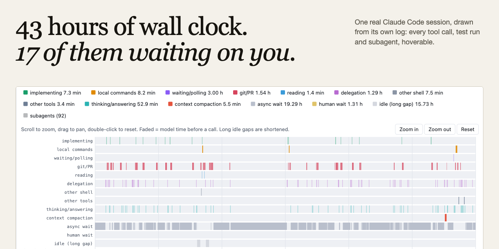
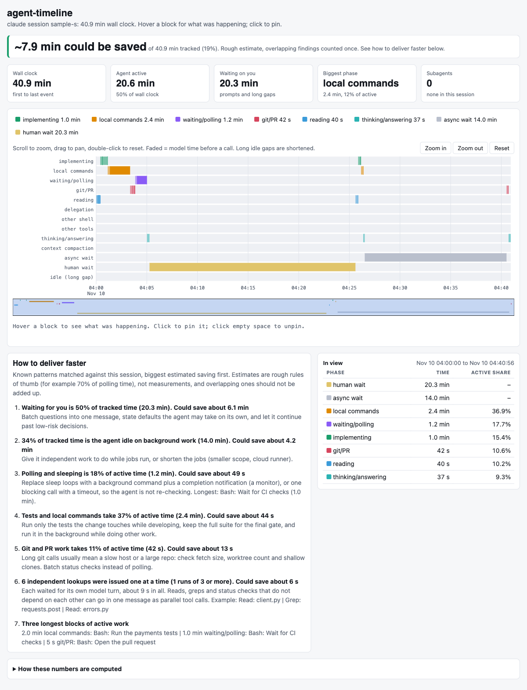
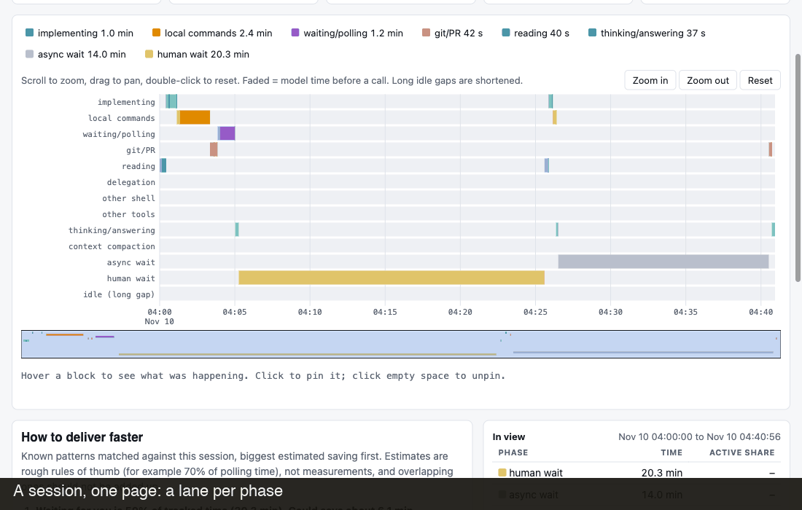
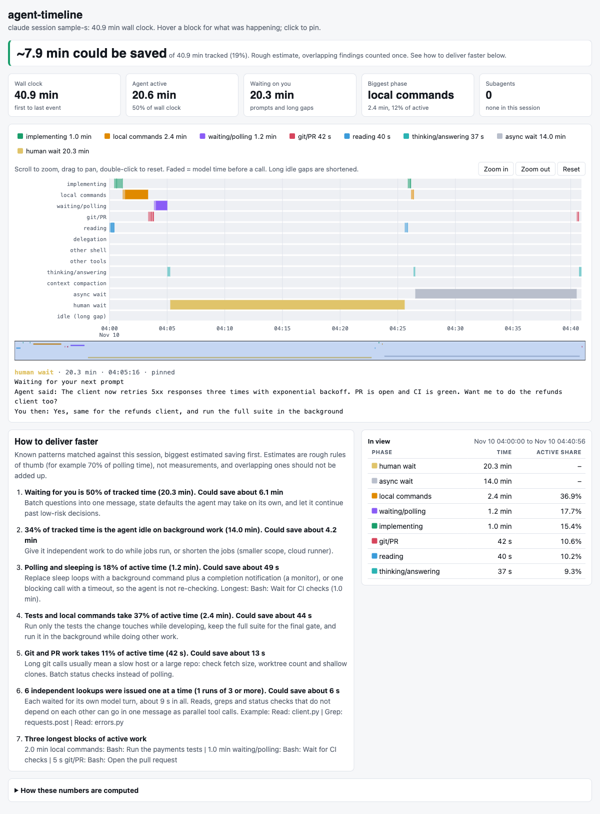

<p align="center">
  
</p>

<h1 align="center">agent-timeline</h1>

<p align="center">
  <em>Your agent says it was "working" for 40 minutes. Where did the time go?</em>
</p>

<p align="center">
  
  
  
</p>

<p align="center">
  <a href="https://rivusglobal.github.io/agent-timeline/demo.html"></a>
</p>

<p align="center">
  <strong>One command. One self-contained HTML file. Zoom, drag, hover, pin.</strong><br>
  <a href="https://rivusglobal.github.io/agent-timeline/demo.html">Open the live demo</a> (a made-up session, nothing real in it).
</p>

---

A 40-minute session is rarely 40 minutes of work. Some of it is the model thinking, some of it is tests, some of it is the agent polling a job it could have been told about, and a lot of it is waiting for you to type. The transcript has every timestamp. Nobody reads a transcript.

agent-timeline reads it for you and draws it.

<p align="center">
  
</p>

## What you get

- **A lane per phase.** Implementing, local commands, waiting/polling, git/PR, reading, delegation, thinking, context compaction, async wait, human wait. Faded = model time before a call.
- **Hover anything.** Even a 1px block: hit-testing is by lane and time with a few pixels of tolerance, so hairline blocks and the gaps between them still answer. Click to pin.
- **Context on the waits.** A "human wait" block shows what the agent had just said and the prompt that ended the wait, so you can tell *why* it sat for 20 minutes.
- **Zoom, pan, minimap, phase filters,** and per-window stats for exactly what is on screen.
- **"How to deliver faster."** Known patterns matched against your session, biggest saving first: serial lookups that could be one parallel message, sleep loops, subagents run back to back.
- **Honest numbers.** A built-in "How these numbers are computed" section. Gaps over 30 minutes are drawn as idle, shortened on the axis, real on the tooltip.

<p align="center">
  
</p>

## How it works

1. **Read the log.** The transcript already has a timestamp on every message and tool result. Nothing is instrumented and nothing is sent anywhere.
2. **Charge every second to one phase.** Model time before a call goes to that call's phase (a `pytest` run is *local commands*, `sleep` or a status poll is *waiting/polling*, `git`/`gh` is *git/PR*). Silence before your next prompt is *human wait*; silence before a hook or background result is *async wait*; a gap over 30 minutes is *idle*. Compaction is carved out as its own phase, so no second is counted twice.
3. **Draw it.** One self-contained HTML file: lanes, minimap, filters, per-window stats, and a "How to deliver faster" list matched against the numbers. The method is spelled out at the bottom of every page.

## Install

**Claude Code**, as two separate prompts:

```
/plugin marketplace add rivusglobal/agent-timeline
```
```
/plugin install agent-timeline@agent-timeline
```

**Any other agent, or no agent:** it is plain Python 3.12, standard library only.

```bash
git clone https://github.com/rivusglobal/agent-timeline
python3.12 agent-timeline/skills/agent-timeline/agent_timeline.py --open
```

**Cursor:** the skill folder is a standard agent skill, so link it once and Cursor can run it, plus a `/agent-timeline` command:

```bash
ln -s "$PWD/agent-timeline/skills/agent-timeline" ~/.cursor/skills/agent-timeline
mkdir -p ~/.cursor/commands && cp agent-timeline/.cursor/commands/agent-timeline.md ~/.cursor/commands/
```

Inside this repo, `.cursor/rules/agent-timeline.mdc` already tells Cursor when to use it. Cursor reads *other* tools' sessions: its own transcripts carry no per-call timestamps, so they cannot be drawn.

## Use

```bash
python3.12 agent_timeline.py --open                      # newest session on this machine
python3.12 agent_timeline.py --agent claude|codex|opencode
python3.12 agent_timeline.py --session <id-prefix>
python3.12 agent_timeline.py path/to/session.jsonl --out timeline.html
python3.12 agent_timeline.py --no-detail --open          # share-safe: phases and durations only
python3.12 agent_timeline.py --card card.svg             # 1200x630 share card: wall clock and who you waited on (numbers only)
```

In Claude Code, `/agent-timeline` does the same and tells you the two or three things the numbers say.

| Agent | Source | Timing |
|---|---|---|
| Claude Code | `~/.claude/projects/*/*.jsonl` | per tool call |
| Codex CLI | `~/.codex/sessions/**/rollout-*.jsonl` | per tool call (verified on hand-built fixtures) |
| OpenCode | `~/.local/share/opencode/opencode.db` | per assistant message |

## Privacy

Everything runs locally; the page is one file with no network calls. Each block carries a short label from the tool call itself (a Bash description or first command line, a file name, a search pattern), and wait blocks carry a 200-character snippet of the agent's last message and of your next prompt. All of it is redacted for common secret shapes, which is **best effort**. Before you share a page, run it with `--no-detail`: that drops every label, snippet and subagent description and leaves phase names and durations only.

## FAQ

**Does it change my session or send anything anywhere?**
No. It reads the log and writes an HTML file.

**Why is a 3-hour gap drawn so short?**
Gaps over 30 minutes are `idle (long gap)`, drawn 90 seconds wide so they do not swallow the axis. The tooltip shows the real time.

**Can it read Cursor or Aider sessions?**
Not yet. Cursor's own transcripts carry no per-call timestamps (it can still *run* this, see Install). Aider isn't supported. Adding an agent is one function: see [CONTRIBUTING](.github/CONTRIBUTING.md).

## License

[MIT](LICENSE).
